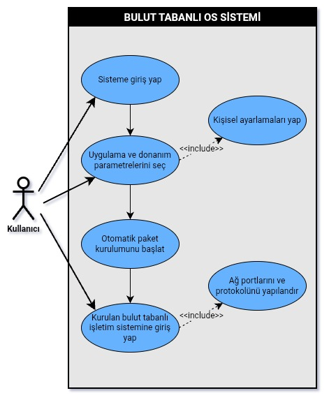
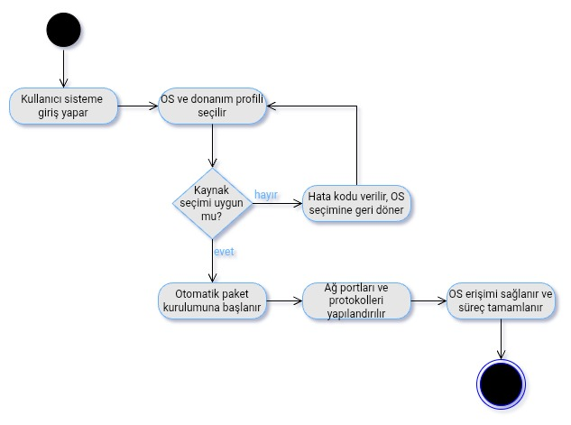
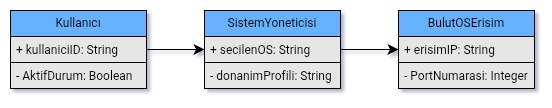

# msc-research

# BULUT TABANLI GELİŞTİRME ALTYAPILARINDA AÇIK KAYNAKLI ARAÇLARLA ALTERNATİF OS ENTEGRASYONU, SİSTEM OPTİMİZASYONU VE İSTEMCİ AKIŞ PERFORMANSI ANALİZİ

## Problem
Yazılım geliştirme ve test süreçlerinde kullanılan bulut tabanlı platformların; mobil cihaz kullanan veya yerel donanım imkânsızlığı yaşayan bireyler tarafından tam donanımlı bir masaüstü çalışma ortamı olarak kullanılabilirliğinin ve sınırlarının net olmaması. Tam donanımlı masaüstü yazılımlarına doğrudan erişilememesi ve mimari uyumsuzluklar nedeniyle başvurulan bu ücretsiz veya düşük maliyetli bulut platformlarının, kullanıcıya masaüstü işlevselliğini kazandırmadaki yetkinliği ile bu süreçte karşılaşılan performans ve erişilebilirlik kısıtlarının bilinmemesi.

## Amaç ve önem
* **Amaç:** Bulut tabanlı geliştirme altyapılarında hafifletilmiş masaüstü ortamı ve uzaktan erişim katmanları kurarak mobil ve kısıtlı cihazlar için optimize bir masaüstü çalışma ortamı sağlamak ve performansını ölçmek.
* **Önem:** Donanımı yetersiz olan kişilerin bulut sistemleri üzerinden tam masaüstü deneyimi alabilmesi için pratik bir kullanım rehberi sunmasıdır.

## Hipotez
* **Alternatif Hipotez (H1):** Doğru uzaktan erişim protokolleri ve sistem optimizasyonları uygulandığında; bulut geliştirme ortamları mobil cihazlarda masaüstü seviyesinde işlevsel bir çalışma ortamı sağlar.
* **Sıfır Hipotezi (H0):** Farklı uzaktan erişim protokolleri ve sistem optimizasyonlarının uygulanması, mobil cihazlarda sağlanan masaüstü çalışma ortamının performansı üzerinde anlamlı bir fark yaratmaz.

## Sayıltı ve sınırlılıklar
* **Sayıltılar:** Kullanılan bulut altyapısının test süresince kararlı bir internet bağlantısına ve yeterli sanal kaynak tahsisine sahip olduğu varsayılmaktadır.
* **Sınırlılıklar:** Çalışma, QEMU/KVM sanallaştırma katmanı üzerinde çalıştırılan Windows (7, 8.1, 10, 11, LTSC sürümleri), Linux işletim sistemleri, seçilen uzaktan erişim protokolleri ve bu protokollerin kullandığı kodekler ile sınırlıdır.

## Ekipler ve rolleri
* **Geliştirici / Araştırmacı:**
    * **@mstfsmtcnkr** - Sistem mimarisinin kurulması, uzaktan erişim protokollerinin entegrasyonu, performans testlerinin yürütülmesi ve veri analizi.

## Literatür(Ön yüz taraması)
* **Magaña, E., Izquierdo, R., & Perallos, A. (2019).** *Remote access protocols for Desktop-as-a-Service solutions: A performance comparison.* PLOS ONE, 14(1), e0207512.
  - **Özet ve İlişki:** DaaS ortamlarında VNC, RDP ve WebRTC gibi protokollerin bant genişliği, gecikme ve işlemci yükü performansını incelemektedir. Çalışmamızda uzaktan erişim protokollerinin mobil cihazlardaki akış performansını değerlendirirken bu çalışmanın sunduğu metrikler temel alınacaktır.

* **Balen, J., Zagar, D., & Hocenski, Z. (2020).** *Performance evaluation of Windows virtual machines on a Linux host.* Automatika, 61(3), 425–435.
  - **Özet ve İlişki:** Linux sunucular üzerinde çalıştırılan Windows sanal makinelerinin (KVM/QEMU) kaynak kullanımı ve I/O performansını analiz etmektedir. Projemizdeki sanallaştırma katmanının kaynak tüketim kısıtlarını öngörmek için bu kaynaktan yararlanılacaktır.

* **Sobieraj, S., & Kotyński, G. (2024).** *Docker Performance Evaluation across Operating Systems.* Applied Sciences, 14(15), 6672.
  - **Özet ve İlişki:** Docker konteyner yapılarının farklı işletim sistemleri üzerindeki ek yükünü (overhead) deneysel olarak karşılaştırmaktadır. Bulut ortamında yapılacak optimizasyonlarda bu bulgular referans alınacaktır.

## Veri seti: Kaynak ve bağlantı bilgisi
* **Kaynak:** Deneysel sistem performans ölçüm logları ve SQLite veritabanı kayıtları.
* **İçerik:** CPU/RAM kullanım metrikleri, yanıt süreleri ve istemci bağlantı logları.

## İlk yöntem:
İlk aşamada bulut geliştirme ortamı içerisine alternatif bir işletim sistemi ve gerekli uzaktan erişim katmanları kurulacaktır. Kurulan bu sistem üzerinde farklı protokoller denenerek elde edilen performans kayıtları SQLite veritabanında toplanacak ve metrik bazlı kıyaslama ile zaman serisi analizi yapılacaktır.(değişebilir)

## UML Diyagramları ve Açıklamaları

### 1. Use Case Diagram (Kullanım Durumu Diyagramı)

* **Sisteme Giriş Yap:** Kullanıcı aktörü, bulut platformundaki oturumunu başlatmak için sisteme yetkili olarak giriş yapar.
* **Uygulama ve Donanım Parametrelerini Seç:** Kullanıcı, çalıştırılacak alternatif işletim sisteminin donanım ve yazılım gereksinimlerini belirler.
* **Kişisel Ayarlamaları Yap (`<<include>>`):** Parametre seçimi adımıyla doğrudan bağlantılı çalışan bu alt modül, kullanıcının özel oturum ve ortam tercihlerini sisteme tanımlar.
* **Otomatik Paket Kurulumunu Başlat:** Seçilen konfigürasyona uygun olarak konteyner/sanallaştırma ortamında otomatik paket ve sistem kurulumları tetiklenir.
* **Kurulan Bulut Tabanlı OS'a Giriş Yap:** Kurulum tamamlandıktan sonra kullanıcı masaüstü ortamına erişim sağlar.
* **Ağ Portlarını ve Protokolünü Yapılandır (`<<include>>`):** Erişim adımıyla entegre çalışan bu alt modül, istemci akış performansı için gerekli port yönlendirmelerini ve düşük gecikmeli görüntü akış protokollerini aktif eder.

---

### 2. Activity Diagram (Etkinlik Diyagramı)

* **Başlangıç (`●`):** Akış, başlangıç düğümü ile başlar ve kullanıcının sisteme giriş yapmasıyla aktifleşir.
* **OS ve Donanım Profili Seçilir:** Kullanıcı tarafından hedeflenen sistem ve donanım parametreleri sisteme girilir.
* **Kaynak Seçimi Uygun mu? (Karar Karosu):** Sistem, seçilen konfigürasyonun bulut sunucu kaynakları ile uyumlu olup olmadığını denetler.
* **Hata Kodu Verilir (Hayır Kolu):** Kaynak seçimi uygun değilse (`hayır`), kullanıcıya hata kodu verilerek akış tekrar profil seçimi adımına yönlendirilir.
* **Otomatik Paket Kurulumu ve Yapılandırma (Evet Kolu):** Kaynaklar uygunsa (`evet`), otomatik paket kurulumuna başlanır ve hemen ardından ağ portları ile akış protokolleri yapılandırılır.
* **Bitiş (`◎`):** OS erişimi sağlanarak süreç başarıyla tamamlanır ve bitiş düğümü ile sonlandırılır.

---

### 3. Class Diagram (Sınıf Diyagramı)

* **Kullanıcı Sınıfı:** Sisteme erişim sağlayan kullanıcının kimlik bilgisini (`+ kullaniciID: String`) ve oturum durumunu (`- AktifDurum: Boolean`) temsil eden veri sınıfıdır.
* **SistemYoneticisi Sınıfı:** Kullanıcıdan gelen talebe göre arka planda seçilen işletim sistemini (`+ secilenOS: String`) ve donanım profilini (`- donanimProfili: String`) yöneten ana kontrol sınıfıdır.
* **BulutOSErisim Sınıfı:** Kurulum tamamlandıktan sonra istemcinin canlı akış görüntüsüne ve masaüstü arayüzüne erişebilmesi için gerekli IP adresini (`+ erisimIP: String`) ve port numarasını (`- PortNumarasi: Integer`) tanımlayan erişim sınıfıdır.

## Kaynakça

* Magaña, E., Sesma, I., Morató, D., & Izal, M. (2019). Remote access protocols for Desktop-as-a-Service solutions. *PLOS ONE*, 14(1), e0207512. https://doi.org/10.1371/journal.pone.0207512
* Balen, J., Vdovjak, K., & Martinović, G. (2020). Performance evaluation of Windows virtual machines on a Linux host. *Automatika*, 61(3), 425–435. https://doi.org/10.1080/00051144.2020.1775961
* Sobieraj, M., & Kotyński, D. (2024). Docker Performance Evaluation across Operating Systems. *Applied Sciences*, 14(15), 6672. https://doi.org/10.3390/app14156672
